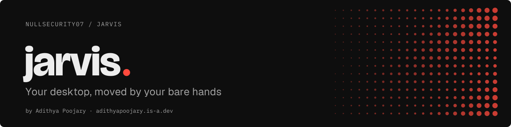
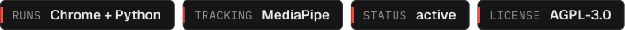
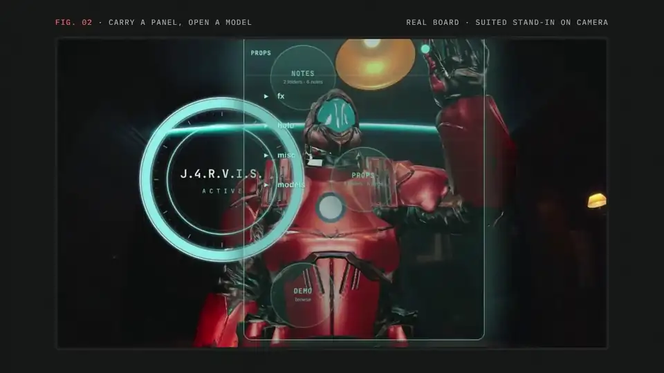
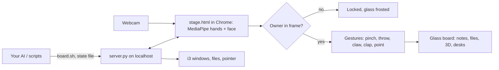

<p align="center"><a href="https://adithyapoojary.is-a.dev/work/jarvis/"><picture><source media="(prefers-color-scheme: light)" srcset=".github/readme/banner-light.svg"></picture></a></p>
<p align="center"><picture><source media="(prefers-color-scheme: light)" srcset=".github/readme/badges-light.svg"></picture></p>

Jarvis is a hand-tracked glass board over your webcam feed: notes, images, 3D models and even live windows from your desktop float as glass cards you pinch, throw and pull apart with your bare hands. Only the owner's face can drive it. For Linux tinkerers who want a hands-in-the-air desktop and a stage for their AI agents.

<p align="center"><a href="https://adithyapoojary.is-a.dev/work/jarvis/"></a><br><sub>A clip from the walkthrough. <a href="https://adithyapoojary.is-a.dev/work/jarvis/">Watch the full video</a>.</sub></p>

## Highlights

- **Owner lock.** The board enrolls one face and stays locked to it. Step away and it frosts over and ignores every gesture; anyone else's hands do nothing. A guest can be let in with a pinch or a thumbs up, and only while they stay close. Face matching runs in the browser and nothing leaves the machine.
- **Your desktop on the glass.** A Desks orb lists your i3 workspaces and streams live windows onto the board as cards, even windows sitting behind it. Point to arm, pinch to click inside a card, make a fist to let go.
- **Your files, read-only.** A Files orb opens PDFs, code, images, video and 3D models from folders you name, jailed to those folders. There is no write, delete or execute path.
- **A stage for an AI.** The ring is a face any program can drive by writing a file, and `bin/board.sh` lets an agent present a card, open a file or stage a window, through a server-side allowlist.
- **Tuned to a real hand.** Every gesture threshold lives in `tuning.json`, fitted from recorded hand data with the tools in `tools/`.

## How it works



1. `server.py` (standard-library Python) serves the board on `127.0.0.1:8794` and owns everything that touches the system: file roots, i3 windows and the pointer, each behind an allowlist.
2. `stage.html` runs hand and face tracking in Chrome and draws the glass board over the camera feed.
3. The owner lock gates every gesture and every pointer move.
4. `launch.sh` opens the board full screen and click-through, so your hands drive the real mouse and clicks land on the apps underneath.

## Quick start

Linux, a webcam and Chrome. The board itself needs only Python 3:

```bash
git clone https://github.com/NullSecurity07/jarvis.git
cd jarvis
cp jarvis.json.example jarvis.json   # optional: orbs, file roots, desks, pointer
python3 server.py
```

Open http://127.0.0.1:8794/stage.html?mode=mirror&hud=1 in Chrome, allow the camera, and face it for about 3 seconds to enroll as the owner. Tap the ring to open the orbs.

The full-screen launcher, Desks and the pointer need i3 on X11, `xdotool` and `google-chrome-stable`:

```bash
./launch.sh
```

Run the tests with `node --test tools/test_*.mjs`. Gesture tuning and camera troubleshooting are in [TROUBLESHOOTING.md](TROUBLESHOOTING.md).

## Project layout

```
server.py          localhost server: config, files, desks, pointer, board commands
stage.html         the board: tracking, gestures, glass cards
js/                owner lock, face identity worker, pose helpers
bin/               board.sh and board-state.sh for scripts and agents
tools/             click-through, window capture, replay and tests
tuning.json        every gesture and camera threshold
sample-notes/      notes that teach the gestures from inside the board
```

## Built on

Jarvis is a fork of [barehands](https://github.com/jaredrhod/barehands) by Jared Rhodenizer, which created the hand-tracked glass board, the gestures, the 3D exploded views and the ring as a face for an AI. This fork adds the owner lock, the Desks and Files orbs, pointer control with click-through, and the `tuning.json` fitting workflow. Hand tracking is [Google MediaPipe](https://developers.google.com/mediapipe), 3D is [three.js](https://threejs.org), and face identity is face-api.js.

## Status

Active. Built and tuned on one i3 machine. The board runs anywhere Chrome and Python do; the desktop features are i3 and X11 only for now.

## Built by

Built by [Adithya Poojary](https://adithyapoojary.is-a.dev), founder of ThreatScope. [More projects](https://adithyapoojary.is-a.dev/work/) · [LinkedIn](https://www.linkedin.com/in/adithyapoojary/)

## Credits

- 3D model `DamagedHelmet.glb`: glTF rebuild by ctxwing ([CC BY 4.0](https://creativecommons.org/licenses/by/4.0/)) of an earlier model by theblueturtle_ ([CC BY-NC 4.0](https://creativecommons.org/licenses/by-nc/4.0/)), via the [Khronos glTF sample assets](https://github.com/KhronosGroup/glTF-Sample-Assets/tree/main/Models/DamagedHelmet). Non-commercial use only.
- 3D model `ToyCar.glb`: CC0.

## License

AGPL-3.0-or-later, the same license as barehands. Original work copyright Jared Rhodenizer; changes in this fork copyright Adithya Poojary (nullsec). See [LICENSE](LICENSE).
